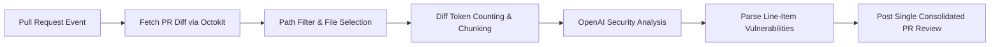

# 🛡️ Secure-AI-Code-Review-Action

> **Automated DevSecOps GitHub Action designed to catch security flaws, race conditions, and missing unit test coverage before code hits the main branch.**

[](https://opensource.org/licenses/MIT)
[](https://github.com/features/actions)
[](https://openai.com)

---

## 🎯 The "Why"

Modern engineering teams move fast, but security reviews often lag behind or introduce bottlenecks. Generic AI code review tools frequently drown developers in noise—nitpicking variable names, stylistic formatting, or spewing polite conversational filler ("As an AI, I recommend...").

**Secure-AI-Code-Review-Action** is purpose-built for high-velocity DevSecOps. It shifts security and resilience testing left by analyzing Pull Request diffs strictly through the lens of a **pragmatic, senior human security engineer**.

### Core Review Focus:
- **OWASP Top 10 Vulnerabilities:** Catches SQL/NoSQL/Command injection, cross-site scripting (XSS), server-side request forgery (SSRF), broken access control, insecure deserialization, and path traversal.
- **Concurrency & Race Conditions:** Detects unsynchronized shared mutable state, data races, deadlocks, and time-of-check to time-of-use (TOCTOU) bugs under concurrent execution.
- **Unhandled Exceptions:** Identifies missing `try/catch` handlers, unhandled promise rejections, and failure points in external I/O or network operations.
- **Missing Unit Test Coverage:** Flags new or modified functions lacking unit test cases and boundary condition validation.
- **Hardcoded Secrets:** Stops exposed API tokens, private keys, database credentials, and secret constants from entering version control.
- **Zero Stylistic Nitpicking:** Intentionally ignores whitespace, indentation, formatting, and naming preferences to eliminate PR fatigue.
- **Single Consolidated Review:** Eliminates notification spam by posting exactly **one consolidated review comment** with precise line-item annotations.

---

## 🛠️ Tech Stack

- **Runtime & Language:** [TypeScript](https://www.typescriptlang.org/) (ESNext, Node 20)
- **CI/CD Integration:** [GitHub Actions Toolkit](https://github.com/actions/toolkit) (`@actions/core`, `@actions/github`, `@octokit/action`)
- **Intelligence Engine:** [OpenAI API](https://platform.openai.com/) (`gpt-4o-mini`, `gpt-4o`, `o3-mini`, etc.)
- **Diff & Context Engine:** High-performance unified diff parser with [@dqbd/tiktoken](https://github.com/dqbd/tiktoken) token counting and intelligent context chunking.

---

## 🚀 Quickstart & Usage

### 1. Prerequisites
1. Generate an OpenAI API key with access to chat completion models (recommended: `gpt-4o-mini` or `gpt-4o`).
2. Add the key to your repository's secrets as `OPENAI_API_KEY` (**Settings > Secrets and variables > Actions > New repository secret**).

### 2. Workflow Configuration
Create `.github/workflows/security-review.yml` in your repository:

```yaml
name: Secure AI Code Review

on:
  pull_request:
    types: [opened, synchronize, reopened]

permissions:
  contents: read
  pull-requests: write

concurrency:
  group: ${{ github.workflow }}-${{ github.event.pull_request.number || github.ref }}
  cancel-in-progress: true

jobs:
  security-review:
    name: DevSecOps AI Review
    runs-on: ubuntu-latest
    steps:
      - name: Checkout Code
        uses: actions/checkout@v4

      - name: Run Secure AI Code Review Action
        uses: ./ # Or your-org/secure-ai-code-review-action@v1
        env:
          GITHUB_TOKEN: ${{ secrets.GITHUB_TOKEN }}
          OPENAI_API_KEY: ${{ secrets.OPENAI_API_KEY }}
        with:
          openai_heavy_model: 'gpt-4o-mini'
          openai_model_temperature: '0.0'
          debug: false
          path_filters: |
            !dist/**
            !**/*.lock
            !**/*.min.js
            !**/*.json
            !**/*.md
```

---

## ⚙️ Configuration Options

| Input | Description | Required | Default |
| :--- | :--- | :---: | :--- |
| `openai_heavy_model` | OpenAI model utilized for security evaluation and diff analysis | No | `gpt-4o-mini` |
| `openai_model_temperature` | Model sampling temperature (lower is more deterministic) | No | `0.05` |
| `openai_retries` | Maximum retry attempts for OpenAI API calls | No | `5` |
| `openai_timeout_ms` | Request timeout in milliseconds | No | `360000` |
| `max_files` | Maximum number of changed files to analyze (`0` for unlimited) | No | `150` |
| `path_filters` | Multi-line glob patterns to include or exclude specific file paths | No | Excludes binary, generated, and asset files |
| `system_message` | Override the default pragmatic security engineer system prompt | No | *(Pre-configured senior security engineer persona)* |
| `debug` | Enable verbose debug logging in GitHub Actions console | No | `false` |
| `disable_review` | Temporarily skip the review execution | No | `false` |

---

## 🔄 Execution Pipeline



1. **Diff Extraction:** Compares the base branch against the PR head commit to extract unified diff patches.
2. **Context Budgeting & Chunking:** Evaluates token density per hunk using Tiktoken, automatically chunking large diffs to avoid context overflow.
3. **Security Analysis:** Dispatches hunks to OpenAI with instructions enforcing direct, terse peer feedback.
4. **Consolidated Review:** Assembles findings into an executive report and posts a single GitHub review with line-item annotations directly on the vulnerable code lines.

---

## 🛡️ Example Review Comment Output

> **## 🛡️ Secure-AI-Code-Review-Action Report**
>
> ### 📊 Executive Security Summary
> - **Scanned Files:** 4
> - **Security Findings & Gaps:** 2
>
> ### ⚠️ Critical Findings Requiring Attention Before Merging
> - **`src/services/auth.ts` (L45-48):** Good logic here, but this SQL query is vulnerable to injection if the input isn't sanitized.
> - **`src/handlers/payment.ts` (L102-110):** We're missing a unit test for this edge case. Let's add it before merging.
>
> *Please inspect the line-item annotations below for specific remediation code and recommendations.*

---

## 👤 Author & Maintainer

- **Author:** Irene Therese Joseph
- **License:** [MIT](LICENSE)
